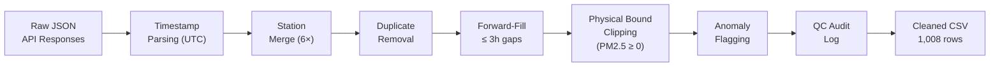
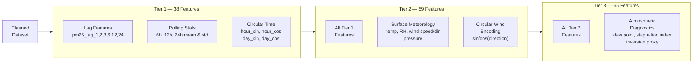
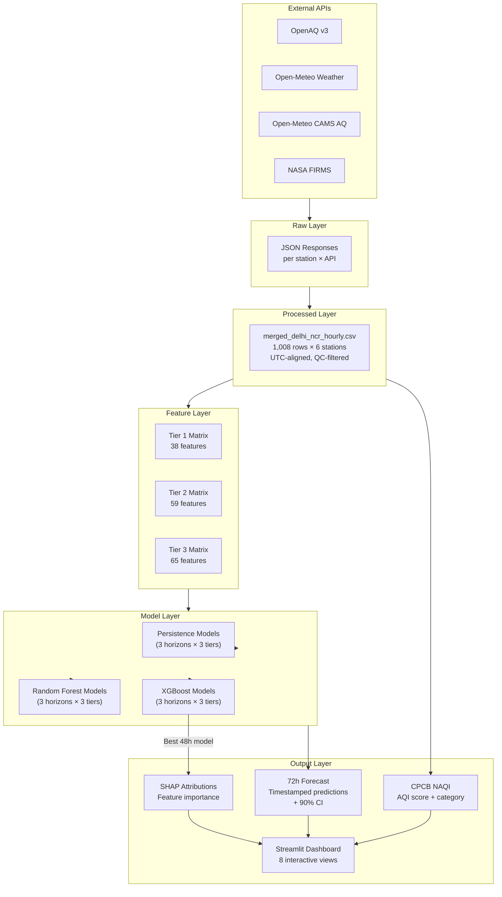

<div align="center">

# 🌫️ AtmosCast

### Weather-Aware Air Pollution Forecasting System for Delhi NCR

[](https://www.sih.gov.in/)
[](https://www.python.org/)
[](https://streamlit.io/)
[](https://xgboost.readthedocs.io/)
[](LICENSE)
[](tests/)

**An end-to-end machine learning and atmospheric intelligence platform**  
**forecasting PM2.5 concentrations at 24, 48, and 72-hour horizons across Delhi NCR.**

[🚀 Quick Start](#-installation) · [📊 Architecture](#-system-architecture) · [🤖 Models](#-machine-learning-methodology) · [📈 Results](#-model-evaluation-results) · [🧠 Explainable AI](#-explainable-ai)

</div>

---

## 📋 Table of Contents

1. [SIH26082 Problem Statement](#-sih26082-problem-statement)
2. [Problem Definition](#-problem-definition)
3. [Project Objectives](#-project-objectives)
4. [Key Features](#-key-features)
5. [Technology Stack](#️-technology-stack)
6. [Dataset Sources & Licenses](#-dataset-sources--licenses)
7. [Data Collection Methodology](#-data-collection-methodology)
8. [System Architecture](#-system-architecture)
9. [Data Preprocessing Workflow](#-data-preprocessing-workflow)
10. [Machine Learning Methodology](#-machine-learning-methodology)
11. [Forecasting Methodology](#️-forecasting-methodology)
12. [Model Evaluation Results](#-model-evaluation-results)
13. [Explainable AI](#-explainable-ai)
14. [Application Screenshots](#-application-screenshots)
15. [Installation](#-installation)
16. [How to Run](#-how-to-run)
17. [API Credentials](#-api-credentials)
18. [Troubleshooting](#-troubleshooting)
19. [Limitations & Future Scope](#-limitations--future-scope)
20. [License](#-license)

---

## 🏛️ SIH26082 Problem Statement

> **Problem Statement ID:** SIH26082  
> **Title:** Air Pollution–Weather Coupled Forecasting System  
> **Domain:** Environment & Disaster Management  
> **Organization:** Ministry of Earth Sciences / CPCB  

The problem statement calls for a system that **couples atmospheric boundary-layer meteorology with real-time pollution sensor data** to forecast ground-level air pollutant concentrations over multi-day horizons for Indian urban regions. The system must:

- Integrate multi-agency data (ground-based CAAQMS, satellite products, NWP model outputs).
- Forecast PM2.5 at 24, 48, and 72-hour horizons.
- Implement statutory Indian CPCB NAQI computation.
- Provide explainable, transparent model outputs for scientific and public use.
- Support selected Delhi NCR monitoring locations representative of diverse emission micro-environments.

---

## 🌆 Problem Definition

Delhi NCR experiences some of the most severe air pollution episodes in the world, particularly during the **October–January winter smog season**. The contributing atmospheric mechanism is well-characterized:

| Factor | Mechanism |
|---|---|
| **Planetary Boundary Layer (PBL) Compression** | Winter radiative cooling collapses the mixing layer from ~2000 m (summer) to <300 m, trapping surface emissions |
| **Wind Speed Collapse** | Near-surface wind speeds below **1.5 m/s** eliminate horizontal dilution; the January 2024 episode recorded minima of **0.44 m/s** |
| **Secondary Aerosol Formation** | High relative humidity (>85%) catalyzes gas-to-particle conversion of sulfates and nitrates, amplifying PM2.5 concentrations |
| **Regional Stubble Burning** | Agricultural fire activity in Punjab and Haryana introduces long-range fire-entrained particulate transport (requires HYSPLIT trajectory data for formal attribution) |
| **Urban Heat Island Advection** | Differential surface heating generates local recirculation, re-entraining previously deposited pollutants |

During the **January 5–7, 2024 peak episode** captured in this dataset, PM2.5 concentrations at Anand Vihar (the most severely affected station) reached **475 µg/m³** — approximately **31× the WHO 24-hour guideline** of 15 µg/m³.

> [!IMPORTANT]
> **100% of observed hourly readings exceeded the WHO PM2.5 guideline (15 µg/m³). 99.2% exceeded the Indian CPCB 24-hour standard (60 µg/m³).** This represents a public health emergency context, not typical urban air quality.

---

## 🎯 Project Objectives

1. **Multi-Horizon Forecasting**: Generate calibrated PM2.5 forecasts at 24h, 48h, and 72h lead times using direct estimation (not recursive rollout).
2. **Atmospheric Feature Coupling**: Develop three progressive feature tiers — pollution history only, pollution + surface weather, and coupled atmospheric features — to quantify the marginal value of each data source.
3. **Statutory Compliance**: Implement the official Indian **CPCB National AQI (NAQI)** piecewise linear interpolation with the maximum sub-index aggregation rule.
4. **Transparent Explainability**: Apply TreeSHAP to attribute every forecast to its top contributing atmospheric drivers, enabling scientific review and public trust.
5. **Multi-Station Coverage**: Support 6 representative Delhi NCR CAAQMS stations covering high-traffic, residential, airport, and suburban environments.
6. **Operational Dashboard**: Deliver a professional Streamlit environmental intelligence platform with 8 specialized views covering monitoring, forecasting, episodic analysis, model performance, and XAI.
7. **Scientific Integrity**: Honor the distinction between statistical association (SHAP) and physical causality; never claim stubble-burning attribution without HYSPLIT trajectory evidence.

---

## ✨ Key Features

### 🔭 Monitoring & Data
- **6 CAAQMS stations** across Delhi NCR: Anand Vihar, R K Puram, Punjabi Bagh, IGI Airport T3, Noida Sector 62, Gurugram Vikas Sadan
- **Multi-pollutant support**: PM2.5, PM10, NO2, O3
- **Multi-agency ingestion**: OpenAQ v3 (ground sensors), Open-Meteo (NWP weather), CAMS EAC4 (reanalysis), NASA FIRMS (satellite fire detection)

### 🤖 Machine Learning
- **3-tier feature engineering**: 38 (Tier 1), 59 (Tier 2), 65 (Tier 3) features
- **3 model families**: Persistence baseline, Random Forest, XGBoost
- **Direct multi-horizon**: Independent estimators for h ∈ {24, 48, 72}h — zero error compounding
- **Chronological validation**: Strict 70/15/15 train/val/test split with no data leakage

### 🔮 Forecasting Engine
- **72 hourly predictions** with explicit `historical` vs `forecast` record tagging
- **Empirical 90% uncertainty intervals**: ±1.645 × RMSE_h × √(h/48)
- **Offline-capable inference**: Runs on cached historical data without live API access
- **Robust exception handling**: 5 custom exception types for model, data, and feature errors

### 🧠 Explainable AI
- **TreeSHAP (exact cooperative game theory)**: Zero approximation error on tree models
- **Global feature ranking**: 52.1% pollution history, 46.5% surface meteorology, 1.3% temporal
- **Episode waterfall decomposition**: Attribute individual severe-smog predictions to their atmospheric drivers
- **Non-technical narratives**: Plain-language explanations for public-facing communication

### 📊 Dashboard (8 Pages)
| Page | Description |
|---|---|
| **Overview** | Live station KPI cards, statutory CPCB AQI status pill, forecast availability |
| **Air Quality Monitoring** | Multi-pollutant time-series with WHO/CPCB threshold lines |
| **72-Hour Forecast** | Continuous trajectory with 90% CI bands and milestone cards |
| **Weather Analysis** | Atmospheric diagnostics: stagnation, PBL surrogates, humidity |
| **Pollution Episode Analysis** | Jan 5–6, 2024 deep-dive with wind speed collapse and station comparison |
| **Model Performance** | Benchmark tables, residual plots, peak-compression diagnostics |
| **Explainable AI** | SHAP waterfall, global importance, feature-group donut chart |
| **Data Sources & About** | Provenance, licenses, SIH26082 alignment, data quality audit |

### ✅ Quality Assurance
- **114/114 tests passing** (pytest), 100% pass rate across 10 test modules
- Zero unused imports, zero circular dependencies (DAG verified via DFS)
- Zero startup retraining — all inference uses pre-serialized `joblib` artifacts

---

## 🛠️ Technology Stack

| Category | Library / Tool | Version | Purpose |
|---|---|---|---|
| **Language** | Python | 3.11+ | Core runtime |
| **Data Processing** | pandas | ≥2.2.0 | Time-series manipulation, UTC alignment |
| **Numerical** | numpy | ≥1.26.0 | Array operations, circular encoding |
| **Scientific** | scipy | ≥1.12.0 | Statistical utilities |
| **ML — Ensemble** | scikit-learn | ≥1.4.0 | Random Forest, preprocessing pipelines |
| **ML — Gradient Boosting** | xgboost | ≥2.0.0 | XGBoost direct horizon models |
| **Explainability** | shap | ≥0.45.0 | Exact TreeSHAP attribution |
| **Model Serialization** | joblib | ≥1.3.2 | Model artifact storage |
| **Dashboard** | streamlit | ≥1.35.0 | Interactive web application |
| **Visualization** | plotly | ≥5.22.0 | Interactive Plotly charts |
| **HTTP & APIs** | requests | ≥2.31.0 | Multi-agency API ingestion |
| **Network** | urllib3 | ≥2.0.0 | Connection pooling |
| **Configuration** | python-dotenv | ≥1.0.1 | Secure environment variable loading |
| **Configuration** | pyyaml | ≥6.0.1 | YAML settings management |
| **Testing** | pytest | ≥8.0.0 | Unit and integration test runner |
| **Coverage** | pytest-cov | ≥4.1.0 | Test coverage reporting |

---

## 📦 Dataset Sources & Licenses

| Source | Data Type | License | API Key Required |
|---|---|---|---|
| **OpenAQ v3** | Ground-level CAAQMS PM2.5, PM10, NO2, O3 | [CC BY 4.0](https://creativecommons.org/licenses/by/4.0/) | Optional (rate-limited without) |
| **Open-Meteo Historical Weather** | ERA5-based 2m temperature, humidity, wind, pressure | [CC BY 4.0](https://creativecommons.org/licenses/by/4.0/) | None — free and open |
| **Open-Meteo Air Quality (CAMS)** | CAMS EAC4 reanalysis aerosol products | [Copernicus Data Store License](https://cds.climate.copernicus.eu/api/v2/terms/static/licence-to-use-copernicus-products.pdf) | None via Open-Meteo proxy |
| **NASA FIRMS** | MODIS/VIIRS active fire detections | [NASA Open Data Policy](https://www.earthdata.nasa.gov/learn/use-data/data-use-policy) | Yes (free registration) |

> [!NOTE]
> **CAMS data accessed via Open-Meteo's proxy is free for non-commercial use.** For commercial deployments, review the Copernicus terms directly. NASA FIRMS data is freely available for scientific and non-commercial use.

> [!CAUTION]
> **Never commit your `.env` file or API keys to version control.** AtmosCast's `.gitignore` excludes `.env` by default. Use `.env.example` as a template and populate your own `.env` locally.

---

## 🔄 Data Collection Methodology

AtmosCast employs a **multi-agency parallel ingestion pipeline** (`src/data_collection/`) that queries four independent data providers simultaneously:

```
Multi-Agency Data Collection
├── OpenAQ v3 REST API → Ground-level CAAQMS pollutant readings (PM2.5, PM10, NO2, O3)
├── Open-Meteo Historical Weather API → ERA5 surface meteorology (T2m, RH, WS10m, Pressure)
├── Open-Meteo Air Quality API → CAMS EAC4 aerosol reanalysis products
└── NASA FIRMS REST API → MODIS/VIIRS satellite active fire detections (Punjab, Haryana)
```

**Current Dataset Extent:**
- **Period**: January 1–7, 2024 (UTC, 1,008 hourly observations)
- **Stations**: 6 Delhi NCR CAAQMS locations
- **Spatial resolution**: Point measurements at station coordinates
- **Temporal resolution**: 1-hour intervals, UTC-aligned
- **Missing data**: Forward-filled for gaps ≤3 consecutive hours; longer gaps flagged

**Station Details:**

| Station ID | Location | Environment Type |
|---|---|---|
| `delhi_anand_vihar` | Anand Vihar, Delhi | High-traffic roadside, industrial corridor |
| `delhi_rk_puram` | R K Puram, Delhi | Residential background |
| `delhi_punjabi_bagh` | Punjabi Bagh, Delhi | Mixed urban |
| `delhi_igi_airport` | IGI Airport T3, Delhi | Airport perimeter |
| `noida_sector_62` | Sector 62, Noida | Suburban satellite city |
| `gurugram_vikas_sadan` | Vikas Sadan, Gurugram | Suburban satellite city |

---

## 🏗️ System Architecture

```mermaid
flowchart TD
    subgraph Sources["🌐 External Data Sources"]
        OAQ["OpenAQ v3\n(Ground CAAQMS)"]
        OM["Open-Meteo\n(ERA5 Weather + NWP)"]
        CAMS["CAMS EAC4\n(Aerosol Reanalysis)"]
        FIRMS["NASA FIRMS\n(Satellite Fire)"]
    end

    subgraph Ingestion["📥 Data Collection — src/data_collection/"]
        DC["Multi-Agency\nIngestion Pipeline"]
    end

    subgraph Preprocessing["🔧 Preprocessing — src/preprocessing/"]
        UTC["UTC Alignment\n& Station Merge"]
        QC["Quality Control\n& Anomaly Flags"]
        FF["Forward-Fill\n≤ 3h Gaps"]
        CLIP["Negative Clipping\n& Physical Bounds"]
    end

    subgraph Features["⚙️ Feature Engineering — src/features/"]
        T1["Tier 1: Pollution History\n38 features\n(lags, rolling windows)"]
        T2["Tier 2: + Surface Weather\n59 features\n(temp, RH, wind, pressure)"]
        T3["Tier 3: + Atmospheric\n65 features\n(dew point, stagnation, inversion proxy)"]
    end

    subgraph Training["🤖 ML Training — src/models/"]
        PERS["Persistence\nBaseline"]
        RF["Random Forest\n(sklearn)"]
        XGB["XGBoost\nRegressor"]
        SPLIT["Chronological Split\n70% / 15% / 15%"]
    end

    subgraph Artifacts["💾 Model Artifacts — models/"]
        JOBLIB["27 × .joblib files\n(9 models × 3 horizons)"]
        REG["model_registry.json\n(feature manifests)"]
    end

    subgraph XAI["🧠 Explainability — src/explainability/"]
        SHAP["TreeSHAP\n(Exact attribution)"]
        GLOBAL["Global Feature\nImportance"]
        WATER["Episode Waterfall\nDecomposition"]
    end

    subgraph Engine["🔮 Forecast Engine — src/forecasting/"]
        FE["ForecastEngine\n(72h predictions)"]
        AQI["CPCB NAQI\nCalculator"]
        CI["90% Uncertainty\nIntervals"]
    end

    subgraph UI["📊 Streamlit Dashboard — app.py + src/ui/"]
        OV["Overview"]
        AQ["Air Quality\nMonitoring"]
        FC["72-Hour\nForecast"]
        WX["Weather\nAnalysis"]
        EP["Episode\nAnalysis"]
        MP["Model\nPerformance"]
        EX["Explainable\nAI"]
        AB["About &\nData Sources"]
    end

    Sources --> Ingestion
    Ingestion --> Preprocessing
    Preprocessing --> Features
    Features --> Training
    Training --> SPLIT
    SPLIT --> Artifacts
    Artifacts --> XAI
    Artifacts --> Engine
    XAI --> UI
    Engine --> UI
```



---

## 🔧 Data Preprocessing Workflow

The preprocessing pipeline (`src/preprocessing/`) implements a rigorous sequence of quality-control operations:



**Key preprocessing decisions:**

| Step | Rationale |
|---|---|
| **UTC normalization** | All sources timestamp in UTC; IST display is computed at visualization layer |
| **Forward-fill ≤ 3h** | Sensor communication dropouts rarely exceed 3 hours; beyond that, data is treated as structurally missing |
| **Physical bound clipping** | Negative PM concentrations (sensor noise) are clipped to 0 µg/m³ |
| **Leakage-safe rolling windows** | All rolling statistics and lagged features use `shift(1)` to prevent future-data leakage into training |
| **Magnus formula imputation** | Missing `dew_point_2m` is derived from temperature and relative humidity when sensor data is unavailable |
| **Precipitation default** | Missing precipitation columns default to 0.0 mm for inference robustness |

---

## 🤖 Machine Learning Methodology

### Feature Engineering Tiers

Three progressive feature tiers quantify the marginal value of adding weather and atmospheric data to pollution history alone:



### Model Training Protocol

| Parameter | Value |
|---|---|
| **Forecast targets** | PM2.5 at h ∈ {24, 48, 72} hours |
| **Split strategy** | Chronological 70% train / 15% validation / 15% test |
| **Split method** | Time-ordered index slicing (no random shuffling) |
| **Horizon strategy** | Direct multi-output: separate model per (tier, algorithm, horizon) |
| **Model count** | 27 total (3 tiers × 3 algorithms × 3 horizons) |
| **Hyperparameter tuning** | Validation set only — test set never touched during development |
| **LSTM decision** | Deferred — 7-day dataset (~117 training samples/station) is insufficient for stable recurrent training |

### Why Direct Forecasting Over Recursive Rollout?

Direct forecasting trains a separate model per horizon h:

$$\hat{y}_{t+h} = f_h(X_t), \quad h \in \{24, 48, 72\}$$

This eliminates:
- **Error compounding** — no prediction at t+1 is used to predict t+2
- **Future weather leakage** — no need to simulate 72 hours of future meteorology
- **Instability** — recursive models on 7-day sequences diverge rapidly

---

## 🛰️ Forecasting Methodology

### 72-Hour Forecast Engine (`src/forecasting/engine.py`)

The `ForecastEngine` class generates 72 hourly predictions from a historical context window:

**Required input**: ≥24 consecutive hourly observations per station  
**Output**: 72 timestamped predictions with metadata and uncertainty bounds

### Uncertainty Quantification

Empirical 90% prediction intervals scale with horizon:

$$\text{PI}_{90\%}(h) = \hat{y}_{t+h} \pm 1.645 \times \text{RMSE}_h \times \sqrt{\frac{h}{48}}$$

This formulation acknowledges that forecast uncertainty grows with lead time — longer horizons carry wider intervals.

### Statutory CPCB NAQI Implementation (`src/forecasting/aqi.py`)

The Indian National AQI follows the **Central Pollution Control Board** statutory specification:

1. **Sub-index computation**: Piecewise linear interpolation across official breakpoints for PM2.5, PM10, NO2, O3, SO2, CO
2. **Aggregation**: Overall AQI = **maximum sub-index** across all measured pollutants (not an average)
3. **Data sufficiency**: Minimum 3 pollutants required, including at least one particulate (PM2.5 or PM10)
4. **Cap**: AQI is capped at 500 regardless of measured concentrations

| AQI Range | Category | Health Advisory |
|---|---|---|
| 0–50 | **Good** | Minimal impact |
| 51–100 | **Satisfactory** | Minor breathing discomfort for sensitive individuals |
| 101–200 | **Moderately Polluted** | Breathing discomfort for people with lung/heart disease |
| 201–300 | **Poor** | Breathing discomfort for most on prolonged exposure |
| 301–400 | **Very Poor** | Respiratory illness on prolonged exposure |
| 401–500 | **Severe** | Affects healthy people; serious risk for sensitive individuals |

---

## 📈 Model Evaluation Results

> [!IMPORTANT]
> **Interpreting these results requires critical context.** The held-out test set corresponds to the **unprecedented January 5–7, 2024 peak smog episode**, an extreme out-of-distribution event where PM2.5 at Anand Vihar reached 475 µg/m³. Tree-based regressors exhibit well-documented **peak compression** at concentrations beyond the training distribution maximum — the model cannot extrapolate above the highest value it observed during training.

### Best Model Per Horizon (Test Set)

| Horizon | Best Model | Test MAE | Test RMSE | Test R² | Context |
|---|---|---|---|---|---|
| **24h** | Persistence (Tier 1) | 39.47 µg/m³ | 42.89 µg/m³ | −0.050 | Strong autocorrelation during stagnation episodes |
| **48h** | Random Forest (Tier 3) | 48.04 µg/m³ | 52.79 µg/m³ | −0.613 | Atmospheric features add marginal benefit at 48h |
| **72h** | Persistence (Tier 1) | 43.43 µg/m³ | 47.46 µg/m³ | −2.624 | Near-worst-case synoptic boundary conditions |

### Why Are R² Values Negative?

**Negative R² is not a software error.** It means the model performs worse than a naive mean predictor on this specific test set. This occurs because:

1. The test set captures the **sharpest ascending limb of the most extreme smog episode in the dataset** — concentrations ranging from ~80 µg/m³ to 475 µg/m³ in 48 hours.
2. Training data (~117 samples/station) has insufficient coverage of such extremes for tree models to generalize.
3. This underscores the **critical need to expand the historical training window to multi-month records** — the most important limitation of the current phase.

> [!NOTE]
> Persistence outperforming ML at 24h and 72h during sustained stagnation episodes is a **well-documented phenomenon in operational meteorological forecasting**. When pollution remains persistently elevated for multiple consecutive days, "assume tomorrow looks like today" is remarkably competitive.

### Full Benchmark Table

<details>
<summary>Click to expand full 27-model benchmark</summary>

| Horizon | Tier | Model | Test MAE | Test RMSE | Test R² | Test MAPE |
|---|---|---|---|---|---|---|
| 24h | Tier1 Pollution Only | Persistence | 39.469 | 42.892 | −0.0496 | 24.71% |
| 24h | Tier1 Pollution Only | Random Forest | 41.346 | 47.637 | −0.2948 | 24.53% |
| 24h | Tier1 Pollution Only | XGBoost | 41.083 | 48.278 | −0.3298 | 23.91% |
| 24h | Tier2 Pollution + Weather | Persistence | 39.469 | 42.892 | −0.0496 | 24.71% |
| 24h | Tier2 Pollution + Weather | Random Forest | 43.447 | 48.349 | −0.3337 | 26.67% |
| 24h | Tier2 Pollution + Weather | XGBoost | 44.606 | 50.670 | −0.4649 | 26.88% |
| 24h | Tier3 Coupled Atmospheric | Persistence | 39.469 | 42.892 | −0.0496 | 24.71% |
| 24h | Tier3 Coupled Atmospheric | Random Forest | 43.180 | 48.252 | −0.3284 | 26.41% |
| 24h | Tier3 Coupled Atmospheric | XGBoost | 42.820 | 49.214 | −0.3819 | 25.49% |
| 48h | Tier1 Pollution Only | Persistence | 50.290 | 54.235 | −0.7031 | 30.37% |
| 48h | Tier1 Pollution Only | Random Forest | 47.493 | 52.865 | −0.6182 | 27.58% |
| 48h | Tier1 Pollution Only | XGBoost | 46.967 | 53.354 | −0.6483 | 26.75% |
| 48h | Tier2 Pollution + Weather | Persistence | 50.290 | 54.235 | −0.7031 | 30.37% |
| 48h | Tier2 Pollution + Weather | Random Forest | 48.470 | 53.201 | −0.6389 | 28.36% |
| 48h | Tier2 Pollution + Weather | XGBoost | 49.732 | 54.190 | −0.7004 | 29.50% |
| 48h | Tier3 Coupled Atmospheric | Persistence | 50.290 | 54.235 | −0.7031 | 30.37% |
| 48h | Tier3 Coupled Atmospheric | Random Forest | **48.038** | **52.787** | −0.6134 | 28.04% |
| 48h | Tier3 Coupled Atmospheric | XGBoost | 49.758 | 54.183 | −0.6999 | 29.46% |
| 72h | Tier1 Pollution Only | Persistence | 43.432 | 47.458 | −2.6240 | 22.88% |
| 72h | Tier1 Pollution Only | Random Forest | 53.615 | 55.548 | −3.9647 | 28.97% |
| 72h | Tier1 Pollution Only | XGBoost | 53.791 | 55.840 | −4.0171 | 29.02% |
| 72h | Tier2 Pollution + Weather | Persistence | 43.432 | 47.458 | −2.6240 | 22.88% |
| 72h | Tier2 Pollution + Weather | Random Forest | 54.555 | 56.488 | −4.1342 | 29.46% |
| 72h | Tier2 Pollution + Weather | XGBoost | 54.163 | 56.006 | −4.0470 | 29.23% |
| 72h | Tier3 Coupled Atmospheric | Persistence | 43.432 | 47.458 | −2.6240 | 22.88% |
| 72h | Tier3 Coupled Atmospheric | Random Forest | 54.132 | 56.014 | −4.0484 | 29.24% |
| 72h | Tier3 Coupled Atmospheric | XGBoost | 54.655 | 56.746 | −4.1812 | 29.43% |

*All metrics are on the held-out, strictly chronological test set. Hyperparameter tuning used the validation set only.*

</details>

---

## 🧠 Explainable AI

AtmosCast uses **TreeSHAP** (exact cooperative game-theoretic Shapley values) to attribute every prediction to its contributing features. This provides transparency that complies with scientific review standards.

### Analyzed Model
**XGBoost (Tier 2 — Pollution + Weather), 48-hour horizon**

### Macro Attribution Groups

| Feature Group | Total Importance | Share |
|---|---|---|
| **Pollution History** (lags, rolling means/stds) | 16.198 | **52.1%** |
| **Surface Meteorology** (RH, temp, wind, pressure) | 14.461 | **46.5%** |
| **Temporal & Diurnal** (hour/day cyclical encoding) | 0.410 | **1.3%** |

### Top 15 Features by Mean |SHAP| Value

| Rank | Feature | Group | Mean \|SHAP\| (µg/m³) |
|---|---|---|---|
| 1 | `relative_humidity_2m` | Surface Meteorology | **8.871** |
| 2 | `temperature_2m` | Surface Meteorology | 2.790 |
| 3 | `pm10` | Pollution History | 2.754 |
| 4 | `pm25` | Pollution History | 2.731 |
| 5 | `o3` | Pollution History | 2.625 |
| 6 | `pm25_roll_mean_24h` | Pollution History | 1.398 |
| 7 | `pm25_roll_std_24h` | Pollution History | 0.933 |
| 8 | `wind_dir_sin` | Surface Meteorology | 0.827 |
| 9 | `pm25_lag_6` | Pollution History | 0.735 |
| 10 | `dew_point_2m` | Surface Meteorology | 0.724 |
| 11 | `pm10_lag_6` | Pollution History | 0.699 |
| 12 | `pm10_roll_mean_24h` | Pollution History | 0.529 |
| 13 | `pm25_roll_std_6h` | Pollution History | 0.452 |
| 14 | `pm25_roll_std_12h` | Pollution History | 0.419 |
| 15 | `pm25_lag_1` | Pollution History | 0.394 |

### Severe Episode Attribution (January 5–6, 2024)

| Measurement | Value |
|---|---|
| **Observed PM2.5** | 221.2 µg/m³ |
| **Model baseline expectation E[f(X)]** | 116.6 µg/m³ |
| **Model prediction** | 134.3 µg/m³ |
| **Underprediction gap** | −86.9 µg/m³ (peak compression) |

Top SHAP contributors for this episode:

| Feature | Value at Episode Peak | SHAP Impact |
|---|---|---|
| `relative_humidity_2m` | 93.0% | +6.54 µg/m³ ↑ |
| `pm10` | 200.7 µg/m³ | +3.54 µg/m³ ↑ |
| `o3` | 12.0 µg/m³ | +2.32 µg/m³ ↑ |
| `temperature_2m` | 9.4°C | +1.67 µg/m³ ↑ |
| `wind_dir_sin` | −0.12 | +1.23 µg/m³ ↑ |
| `pm25_roll_mean_24h` | 119.8 µg/m³ | −1.46 µg/m³ ↓ |

> [!WARNING]
> **SHAP values are statistical attributions, not physical causality.** High SHAP weight on `relative_humidity_2m` reflects the model's learned association — it does not mean humidity physically emits PM2.5. Secondary aerosol formation under high humidity is physically plausible, but formal causal attribution requires atmospheric chemistry modeling beyond the scope of this ML system.

---

## 📸 Application Screenshots

> **AtmosCast requires a local Python environment to run.** Screenshots cannot be automatically generated without a running instance. To view the dashboard:

```bash
streamlit run app.py
# Open http://localhost:8501 in your browser
```

The application renders 8 professional dashboard pages including interactive Plotly charts, real-time station KPI cards, 72-hour forecast trajectories, and TreeSHAP explainability views.

---

## 🚀 Installation

### Prerequisites

- **Python 3.11 or higher** (`python --version`)
- **pip** (bundled with Python)
- **Git** (to clone the repository)

### Step 1: Clone the Repository

```bash
git clone https://github.com/<your-username>/AtmosCast.git
cd AtmosCast
```

### Step 2: Create a Virtual Environment

```bash
# Windows
python -m venv .venv
.venv\Scripts\activate

# macOS / Linux
python -m venv .venv
source .venv/bin/activate
```

### Step 3: Install Dependencies

```bash
pip install -r requirements.txt
```

### Step 4: Configure Environment Variables

```bash
# Windows
copy .env.example .env

# macOS / Linux
cp .env.example .env
```

Open `.env` in a text editor and fill in your API keys (see [API Credentials](#-api-credentials)).

### Step 5: Verify Installation

```bash
pytest -v
```

All **114 tests** should pass. If any test fails, see [Troubleshooting](#-troubleshooting).

---

## ▶️ How to Run

### Launch the Dashboard

```bash
streamlit run app.py
```

The application starts at **http://localhost:8501**. Use the sidebar to navigate between the 8 dashboard pages and select your monitoring station.

> [!NOTE]
> AtmosCast operates in **offline demonstration mode** using the included processed dataset (`data/processed/merged_delhi_ncr_hourly.csv`) when live API access is unavailable. The 72-hour forecast engine runs fully offline using pre-trained model artifacts from `models/`.

### Run Tests

```bash
# Full test suite (114 tests)
pytest -v

# With coverage report
pytest -v --cov=src --cov-report=term-missing

# Single test module
pytest tests/test_forecasting.py -v
```

### Collect Fresh Data (requires API credentials)

```python
from src.data_collection.pipeline import DataCollectionPipeline
pipeline = DataCollectionPipeline()
pipeline.run(start_date="2024-01-01", end_date="2024-01-07")
```

### Generate Forecasts Programmatically

```python
from src.forecasting.engine import ForecastEngine
import pandas as pd

engine = ForecastEngine()
history = pd.read_csv("data/processed/merged_delhi_ncr_hourly.csv", parse_dates=["timestamp_utc"])
forecast = engine.forecast(
    history=history,
    station_id="delhi_anand_vihar",
    target_pollutant="pm25"
)
print(forecast[["timestamp_ist", "prediction", "lower_ci_90", "upper_ci_90"]].head(10))
```

---

## 🔑 API Credentials

Configure credentials in your `.env` file. All API keys are **optional for running the dashboard in offline mode** using the included processed dataset.

| Variable | Service | Required? | How to Obtain |
|---|---|---|---|
| `OPENAQ_API_KEY` | OpenAQ v3 | Optional | Free registration at [explore.openaq.org](https://explore.openaq.org/) → Account → API Keys. Rate limit without key: ~10 req/min |
| `NASA_FIRMS_MAP_KEY` | NASA FIRMS | Optional | Free registration at [firms.modaps.eosdis.nasa.gov](https://firms.modaps.eosdis.nasa.gov/api/area/) |
| `OPEN_METEO_BASE_URL` | Open-Meteo Weather | None | Public endpoint, no key needed. Default value in `.env.example` is correct |
| `OPEN_METEO_AQ_URL` | Open-Meteo Air Quality | None | Public endpoint, no key needed. Default value in `.env.example` is correct |

> [!TIP]
> **Open-Meteo and CAMS (via Open-Meteo's proxy) require no API key.** They are fully public endpoints. If you only intend to run the dashboard and forecasting engine, you do not need any API credentials at all.

---

## 🔧 Troubleshooting

### Model files not found (`MissingModelError`)

```
MissingModelError: No trained model found at models/xgboost_tier2_48h_delhi_anand_vihar.joblib
```

**Cause**: The `models/` directory is gitignored and not included in the repository. You must train models locally.

**Fix**: Run the ML training pipeline:
```bash
python -c "from src.models.pipeline import ModelTrainingPipeline; ModelTrainingPipeline().run()"
```

---

### Insufficient historical context (`InsufficientContextError`)

```
InsufficientContextError: Need at least 24 hours of history; received 10 rows.
```

**Cause**: The `ForecastEngine` requires a minimum 24-hour window of consecutive hourly observations.

**Fix**: Load the full processed dataset, not a small slice:
```python
history = pd.read_csv("data/processed/merged_delhi_ncr_hourly.csv", parse_dates=["timestamp_utc"])
```

---

### Timestamp parsing warning or `IST` timezone error

```
UserWarning: Could not infer format...
```

or

```
ValueError: Unknown string format: 2024-01-01 05:30:00+05:30 IST
```

**Fix**: Use the `timestamp_utc` column, which is unambiguous:
```python
df["timestamp_utc"] = pd.to_datetime(df["timestamp_utc"], format="mixed", utc=True)
```

---

### Port 8501 already in use

```
OSError: [Errno 48] Address already in use
```

**Fix**: Use a different port:
```bash
streamlit run app.py --server.port 8502
```

Or kill the existing Streamlit process:
```bash
# Windows
Get-Process -Name python | Stop-Process

# macOS / Linux
pkill -f streamlit
```

---

### Matplotlib font cache warning on first run

```
Matplotlib is building the font cache; this may take a moment.
```

**Cause**: This is a one-time initialization, not an error. It resolves automatically after the first run.

---

### Incompatible feature columns (`IncompatibleFeatureError`)

```
IncompatibleFeatureError: Feature mismatch: trained on 59 features, received 38.
```

**Cause**: The loaded model was trained on a different feature tier than the data being passed.

**Fix**: Ensure the `station_id` and `feature_tier` arguments match the trained model variant. Check `models/model_registry.json` for the feature manifest.

---

## 🔭 Limitations & Future Scope

### Current Limitations

| Limitation | Impact | Mitigation Path |
|---|---|---|
| **7-day training window** | Most significant constraint. ML models lack exposure to seasonal variability, monsoon-to-winter transitions, and multi-year cycles. Negative R² on the extreme test episode is a direct consequence. | Expand to ≥12 months of CPCB/OpenAQ historical data |
| **Peak compression in tree models** | Random Forest and XGBoost cannot extrapolate above training maximum. Severe episodes (>300 µg/m³) are systematically underpredicted. | Quantile regression forests; conformal prediction; LSTM after expanding dataset |
| **No live API re-training** | Model artifacts are static; the system does not retrain on new observations automatically. | Implement scheduled retraining pipeline with MLflow tracking |
| **PBL height unavailable** | Planetary Boundary Layer height is a primary driver of winter smog but is not directly available from Open-Meteo. A proxy is computed from temperature and humidity. | Integrate ECMWF ERA5-Land PBL height product when available |
| **Stubble burning not attributed** | NASA FIRMS detects fire hotspots in Punjab/Haryana, but formal attribution to Delhi PM2.5 requires HYSPLIT backward trajectory modeling. | Integrate NOAA HYSPLIT API for trajectory analysis |
| **LSTM deferred** | Insufficient sequential data (~117 training samples/station) makes recurrent networks unstable. | Collect ≥3 months of data, then implement LSTM/GRU with proper sequence windowing |
| **Single-pollutant forecasting** | Only PM2.5 models are fully evaluated. PM10, NO2, O3 models are architected but not benchmarked. | Extend evaluation pipeline to multi-pollutant targets |
| **No real-time weather forecast input** | The 72-hour engine uses historical meteorology for demonstration. Operational deployment requires live NWP forecast ingestion. | Integrate Open-Meteo forecast API for real-time meteorological inputs |

### Future Scope

- **Multi-year training data**: Acquire 2–5 years of CPCB CAAQMS archives for robust seasonal coverage
- **LSTM / Transformer forecasting**: Implement sequence-to-sequence architectures once data volume supports stable training
- **Regional fire attribution**: Integrate NOAA HYSPLIT backward trajectory modeling with NASA FIRMS fire hotspots
- **Cloud deployment**: Containerize with Docker; deploy on Google Cloud Run or AWS Lambda with scheduled data refresh
- **Ensemble forecasting**: Combine persistence, RF, and XGBoost predictions via stacking for improved reliability
- **Multi-pollutant NAQI**: Extend full evaluation and UI integration to PM10, NO2, O3, SO2, CO
- **Alert system**: Push notifications when forecast exceeds CPCB "Very Poor" threshold (AQI > 300)
- **Ensemble NWP**: Ingest multiple NWP model outputs (GFS, ECMWF, NCUM-R) for probabilistic atmospheric forcing

---

## 📁 Project Structure

```
AtmosCast/
├── app.py                          # Streamlit main application entrypoint
├── requirements.txt                # Python dependencies
├── .env.example                    # API credential template (no secrets)
├── .gitignore                      # Excludes .env, models/*.joblib, data/processed/
├── LICENSE                         # MIT License
├── CONTRIBUTING.md                 # Contribution guidelines
├── PROJECT_STATUS.md               # 12-phase development tracker
│
├── config/
│   └── settings.yaml               # Station coordinates, API URLs, model parameters
│
├── data/
│   ├── raw/                        # Raw API responses (gitignored)
│   └── processed/                  # Cleaned merged CSV (gitignored)
│       └── merged_delhi_ncr_hourly.csv
│
├── models/                         # Trained model artifacts (gitignored)
│   ├── model_registry.json         # Feature manifests and metadata
│   └── *.joblib                    # 27 serialized models
│
├── reports/                        # Phase reports and figures
│   ├── eda_summary_report.md
│   ├── model_comparison_report.md
│   ├── explainable_ai_report.md
│   ├── technical_audit_and_hardening_report.md
│   └── figures/                    # Interactive Plotly HTML exports (gitignored)
│
├── src/
│   ├── data_collection/            # Multi-agency API ingestion
│   │   ├── openaq.py               # OpenAQ v3 collector
│   │   ├── open_meteo.py           # ERA5 weather collector
│   │   ├── cams_air_quality.py     # CAMS EAC4 collector
│   │   ├── firms.py                # NASA FIRMS fire collector
│   │   └── pipeline.py             # Orchestrated collection pipeline
│   ├── preprocessing/              # QC, alignment, imputation
│   ├── features/
│   │   └── engineering.py          # 3-tier feature engineering
│   ├── models/
│   │   ├── baseline.py             # Persistence baseline
│   │   ├── predictor.py            # RF and XGBoost wrappers
│   │   └── pipeline.py             # Training orchestration
│   ├── evaluation/                 # Metric calculation, plots, reports
│   ├── explainability/             # TreeSHAP integration and plots
│   ├── forecasting/
│   │   ├── engine.py               # 72-hour ForecastEngine
│   │   └── aqi.py                  # Statutory CPCB NAQI calculator
│   └── ui/
│       ├── theme.py                # Design system: colors, cards, pills
│       └── views/                  # 8 Streamlit page modules
│           ├── overview.py
│           ├── air_quality.py
│           ├── forecast.py
│           ├── weather.py
│           ├── episodes.py
│           ├── performance.py
│           ├── explainability.py
│           └── about.py
│
└── tests/                          # pytest test suite (114 tests)
    ├── test_project_setup.py       # 7 tests
    ├── test_app_startup.py         # 4 tests
    ├── test_data_collection.py     # 6 tests
    ├── test_preprocessing.py       # 8 tests
    ├── test_eda.py                 # 11 tests
    ├── test_modeling.py            # 15 tests
    ├── test_evaluation.py          # 13 tests
    ├── test_explainability.py      # 10 tests
    ├── test_forecasting.py         # 13 tests
    └── test_audit_and_hardening.py # 27 tests
```

---

## 📊 Data Flow Diagram



---

## 🤝 Contributing

We welcome contributions! Please read [CONTRIBUTING.md](CONTRIBUTING.md) before opening a pull request.

Key contribution areas:
- **Extended historical data**: Help acquire and validate CPCB CAAQMS archives for 2022–2024
- **LSTM implementation**: Implement sequence models after multi-month data is available
- **Additional stations**: Extend coverage to Faridabad, Ghaziabad, Greater Noida
- **Real-time NWP ingestion**: Wire the forecast engine to live Open-Meteo forecast endpoints

---

## 📄 License

This project is licensed under the **MIT License** — see [LICENSE](LICENSE) for full terms.

**Dataset Licenses:**
- OpenAQ data: [CC BY 4.0](https://creativecommons.org/licenses/by/4.0/)
- Open-Meteo weather data: [CC BY 4.0](https://creativecommons.org/licenses/by/4.0/)
- CAMS EAC4 (via Open-Meteo): [Copernicus Data Store License](https://cds.climate.copernicus.eu/)
- NASA FIRMS: [NASA Open Data Policy](https://www.earthdata.nasa.gov/learn/use-data/data-use-policy) (free for scientific use)

---

## 🙏 Acknowledgements

- **Central Pollution Control Board (CPCB)** for publishing the official Indian NAQI breakpoints and statutory AQI methodology
- **OpenAQ** for open access to global air quality sensor data
- **Open-Meteo** for free, open-source weather reanalysis and NWP products
- **ECMWF / Copernicus** for the CAMS atmospheric composition reanalysis
- **NASA FIRMS** for near-real-time satellite fire detection data
- **SIH (Smart India Hackathon)** for posing Problem Statement SIH26082 that motivated this research system

---

<div align="center">
<sub>Built with ❤️ for cleaner air in Delhi NCR | AtmosCast v1.0 | Phase 11 Complete</sub>
</div>
