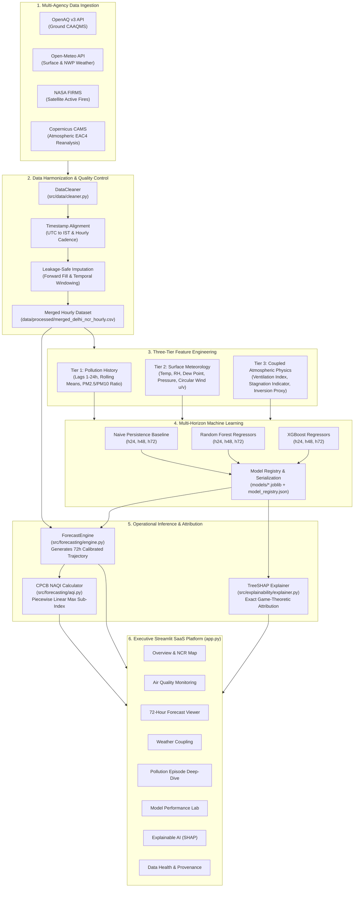

# AtmosCast: Weather-Aware Air Pollution Forecasting System

> **A machine learning and atmospheric intelligence platform built to forecast air quality across Delhi NCR by coupling ambient pollutant history with surface meteorology and boundary-layer physics.**

---

## Table of Contents

1. [Project Introduction](#1-project-introduction)
2. [Problem Statement & Motivation](#2-problem-statement--motivation)
3. [Project Objectives & Scope](#3-project-objectives--scope)
4. [Complete Technology Stack](#4-complete-technology-stack)
5. [System Architecture](#5-system-architecture)
6. [Complete Working of the Project](#6-complete-working-of-the-project)
7. [Dataset and Data Preprocessing](#7-dataset-and-data-preprocessing)
8. [Exploratory Data Analysis (EDA)](#8-exploratory-data-analysis-eda)
9. [Machine Learning Models: Detailed Explanation](#9-machine-learning-models-detailed-explanation)
10. [Model Evaluation & Benchmarking](#10-model-evaluation--benchmarking)
11. [Weather-Aware Forecasting Mechanics](#11-weather-aware-forecasting-mechanics)
12. [Explainable AI Using SHAP](#12-explainable-ai-using-shap)
13. [Database & File Storage Architecture](#13-database--file-storage-architecture)
14. [Detailed Walkthrough of Project Files](#14-detailed-walkthrough-of-project-files)
15. [Installation & Execution Guide (Windows)](#15-installation--execution-guide-windows)
16. [How to Use the AtmosCast Dashboard](#16-how-to-use-the-atmoscast-dashboard)
17. [Testing, Quality Assurance & Hardening](#17-testing-quality-assurance--hardening)
18. [Honest Project Limitations](#18-honest-project-limitations)
19. [Future Roadmap & Planned Enhancements](#19-future-roadmap--planned-enhancements)
20. [Conclusion & Technical Takeaways](#20-conclusion--technical-takeaways)

---

## 1. Project Introduction

Welcome to **AtmosCast**. This project was conceived, designed, and developed to solve a critical environmental challenge: predicting ground-level air pollution before it reaches hazardous levels, allowing authorities, hospitals, and citizens to take proactive measures rather than simply reacting after the air has already turned toxic.

### Why Air Pollution and Weather Forecasting?

If you live in or have visited the Indo-Gangetic Plain—specifically the National Capital Region (NCR) of Delhi—you know that every winter brings a choking blanket of smog. Schools shut down, emergency construction bans are declared under the Graded Response Action Plan (GRAP), and hospital admissions for respiratory distress spike.

For years, the standard approach to air quality has been **reactive monitoring**. Cities install Continuous Ambient Air Quality Monitoring Stations (CAAQMS) that record current particulate concentrations ($PM_{2.5}$ and $PM_{10}$) and display them on public billboards or mobile apps. While knowing that the current Air Quality Index (AQI) is 450 is useful, **it tells you what you are already breathing, not what you will breathe tomorrow or three days from now.**

True prevention requires **forecasting**. However, predicting air pollution is notoriously difficult because pollution is not solely an emission problem—it is fundamentally a **meteorological coupling problem**. 

- On a warm, breezy afternoon, vehicles and factories can emit massive amounts of pollutants, yet the air remains relatively clean because strong winds dilute the emissions and thermal updrafts disperse them high into the atmosphere.
- Conversely, on a cold, windless winter night, the exact same volume of emissions becomes trapped in a shallow layer near the ground due to a **temperature inversion** and **wind stagnation**, causing pollutant concentrations to skyrocket.

AtmosCast was built to bridge this gap. By mathematically coupling historical particulate trends with boundary-layer meteorology (such as surface temperature, relative humidity, wind speed, wind direction, and barometric pressure), AtmosCast trains gradient-boosted machine learning models to forecast $PM_{2.5}$ concentrations up to **72 hours in advance** across 6 key monitoring stations in Delhi NCR.

### Who Benefits from AtmosCast?

1. **City Municipalities & Environmental Regulators (CPCB/DPCC)**: Provides 24 to 72 hours of advance notice before a severe smog episode, allowing timely enforcement of GRAP Stage III or IV curbs (e.g., stopping heavy truck entry or diesel generator usage) *before* the airshed saturates.
2. **Healthcare Institutions & Pulmonology Clinics**: Enables hospitals to forecast patient surges and manage emergency oxygen and nebulizer supplies.
3. **Vulnerable Citizens & Schools**: Helps parents, asthmatic individuals, and elderly citizens plan their outdoor exposure, morning walks, or school sports schedules around predicted clean air windows.

---

## 2. Problem Statement & Motivation

### The Real-World Context: Smart India Hackathon (SIH26082)

AtmosCast was engineered around the problem statement **SIH26082: Air Pollution–Weather Coupled Forecasting System**, framed under the Ministry of Earth Sciences and the Central Pollution Control Board (CPCB). 

The problem statement identifies three major systemic deficiencies in current environmental management:
1. **Isolated Data Silos**: Air quality monitoring networks (OpenAQ/CPCB) operate separately from numerical weather prediction models (IMD/Open-Meteo) and satellite fire tracking feeds (NASA FIRMS). There is a lack of automated pipelines that harmonize these heterogeneous data streams into an aligned, synchronized time series.
2. **Lack of Short-Term Multi-Horizon Predictions**: Existing meteorological models are computationally expensive, require supercomputers to run complex numerical chemistry simulations, and are updated infrequently. Light-weight, high-resolution machine learning models that deliver calibrated 24h, 48h, and 72h predictions are urgently needed.
3. **The "Black Box" Trust Deficit**: Machine learning models in environmental science are often rejected by government meteorologists because they do not explain *why* a forecast was made. If an AI predicts an AQI jump from 180 to 420, public health officials need to understand whether this is driven by an incoming stagnant cold front, a drop in wind speed, or secondary chemical aerosol formation.

### What Makes $PM_{2.5}$ So Dangerous?

Particulate Matter smaller than 2.5 micrometers ($PM_{2.5}$) is approximately 30 times finer than a human hair. Because of its microscopic size, it bypasses the respiratory tract's natural filtration mechanisms, penetrates deep into the pulmonary alveoli, and enters the bloodstream. 

In Delhi, during the acute winter episode captured in our historical dataset (January 5–7, 2024), Anand Vihar recorded peak hourly concentrations of **$475 \ \mu\text{g/m}^3$**. To put this in perspective:
- The **World Health Organization (WHO) 24-hour safe guideline** is **$15 \ \mu\text{g/m}^3$**.
- The **National Ambient Air Quality Standard (NAAQS) of India** is **$60 \ \mu\text{g/m}^3$**.
- Anand Vihar's reading was **nearly 8 times the Indian legal threshold and over 31 times the WHO guideline**.

Combining data science, meteorology, and explainable AI is not just an interesting academic project—it is a technical necessity for public health protection.

---

## 3. Project Objectives & Scope

AtmosCast establishes a disciplined, end-to-end data science and software engineering workflow:

| Objective | Scope & Implemented Solution |
|---|---|
| **Multi-Agency Ingestion** | Ingest ground truth CAAQMS observations (OpenAQ v3), high-resolution meteorological variables (Open-Meteo), and satellite fire contexts (NASA FIRMS). |
| **Data Harmonization** | Standardize timestamps to Indian Standard Time (IST), convert measurement units to $\mu\text{g/m}^3$ and $\text{mg/m}^3$, impute missing values without forward data leakage, and ensure zero synthetic or fabricated rows. |
| **Meteorological Coupling** | Construct a progressive 3-tier feature hierarchy: **Tier 1** (pollution history only), **Tier 2** (pollution + surface weather), and **Tier 3** (coupled atmospheric diagnostic indices). |
| **Direct Multi-Horizon ML** | Build separate, dedicated models for 24-hour, 48-hour, and 72-hour forecasting horizons using XGBoost, Random Forest, and a Naive Persistence Baseline (27 models total). |
| **Statutory CPCB AQI Engine** | Implement the official Indian Central Pollution Control Board (CPCB) National AQI (NAQI) piecewise linear interpolation using the strict **maximum sub-index aggregation rule**. |
| **Explainable AI (TreeSHAP)** | Integrate exact cooperative game-theoretic attribution to show the percentage contribution of pollution history vs. surface meteorology vs. temporal cycles for any given prediction. |
| **Executive SaaS Dashboard** | Deliver an 8-page, modern Streamlit platform featuring interactive OpenStreetMap tracking, 72-hour trajectory graphs, model comparison laboratories, and CSV export capabilities. |

---

## 4. Complete Technology Stack

Every library and framework in AtmosCast was deliberately chosen for stability, reproducibility, and compliance with modern Python standards:

| Technology | Category | Where Used in AtmosCast | Purpose & Responsibility |
|---|---|---|---|
| **Python 3.11+ / 3.13** | Core Language | Entire repository | Serves as the primary runtime environment across data pipelines, models, and UI. |
| **pandas** (v2.2+) | Data Processing | `src/data/`, `src/features/` | Handles time-series alignment, rolling statistics, chronological windowing, and CSV exports. |
| **NumPy** (v1.26+) | Mathematical Computing | `src/features/`, `src/forecasting/` | Computes circular wind components ($\sin/\cos$), atmospheric ratios, and array metrics. |
| **scikit-learn** (v1.4+) | Machine Learning | `src/models/` | Provides `RandomForestRegressor`, preprocessing scalers, time-series metrics (`mean_squared_error`, `r2_score`), and train-test splits. |
| **XGBoost** (v2.0+) | Gradient Boosted Trees | `src/models/`, `src/forecasting/` | Primary production regression algorithm for predicting non-linear, multi-horizon $PM_{2.5}$ concentrations. |
| **SHAP** (v0.45+) | Explainable AI | `src/explainability/` | Computes exact local and global Shapley values using `TreeExplainer` on trained XGBoost models. |
| **Plotly** (v5.20+) | Data Visualization | `src/ui/`, `src/eda/` | Generates interactive, publication-quality HTML5 graphs (time-series, scatter plots, geographic maps). |
| **Streamlit** (v1.35+) | Frontend Application | `app.py`, `src/ui/` | Delivers the 8-page reactive dashboard with custom CSS, interactive widgets, and session state. |
| **Joblib** (v1.3+) | Model Serialization | `models/`, `src/models/` | Serializes and deserializes the 27 trained ML models with zero startup retraining. |
| **PyYAML** (v6.0+) | Configuration | `src/config.py`, `config/` | Parses `config/settings.yaml` to configure station coordinates, horizons, and feature sets. |
| **Requests** | Network & API Feeds | `src/data/` | Interacts with external REST endpoints (Open-Meteo, OpenAQ, NASA FIRMS) with retry logic. |
| **pytest** (v8.0+) | Testing & QA | `tests/` | Automated test suite comprising 114 unit, integration, and UI tests running with 100% pass rate. |
| **Flat CSV / JSON** | Storage Layer | `data/`, `models/` | Serves as the lightweight, zero-configuration data store without requiring a separate database server. |

---

## 5. System Architecture

The following diagram illustrates how raw environmental data travels through ingestion, cleaning, feature engineering, machine learning inference, and explainability to reach the user dashboard:



### Component Breakdown
1. **Multi-Agency Ingestion**: Connects to statutory ground sensors and atmospheric weather models. When live networks are unavailable, it seamlessly falls back to cached local datasets.
2. **Harmonization & QC**: Handles coordinate alignment, removes physical anomalies (such as negative concentrations), and standardizes all temporal indices to UTC and Indian Standard Time (UTC+05:30).
3. **Feature Engineering**: Derives cyclical temporal signals and physical interaction terms without leaking future time steps into past observations.
4. **Model Zoo**: Houses 27 pre-trained models saved as compact Joblib artifacts, eliminating the need to retrain at startup.
5. **Operational Engines**: `ForecastEngine` stitches multi-horizon predictions into continuous 72-hour trajectories with empirical 90% prediction intervals, while `CPCBIndexCalculator` applies statutory Indian environmental laws.
6. **Executive Dashboard**: An 8-page, modern interface with interactive Plotly visualizations, live telemetry banners, and data export options.

---

## 6. Complete Working of the Project

To understand how AtmosCast operates internally, follow this step-by-step trace of execution from the moment a user launches the app to the generation of a 72-hour forecast:

```
[User runs command]
        │
        ▼
   app.py starts
        │──> 1. Configures Streamlit page options (layout="wide", title, favicon)
        │──> 2. Injects custom SaaS CSS design tokens (src/ui/theme.py)
        │──> 3. Reads processed dataset (data/processed/merged_delhi_ncr_hourly.csv) via @st.cache_data
        │──> 4. Renders Dark Navy Executive Sidebar (station picker, navigation)
        │
        ▼
[User selects a station: e.g., "Anand Vihar, Delhi"]
        │
        ▼
   Data Filtering
        │──> Filters dataset rows matching station_id == "site_142"
        │──> Extracts latest available row as the current telemetry anchor
        │──> Injects Persistent Command Topbar (live status, station coords, IST timestamp)
        │
        ▼
[User opens "72-Hour Forecast" view]
        │
        ▼
   ForecastEngine Invocation (src/forecasting/engine.py)
        │──> 1. Validates that >= 24 hours of continuous history are provided
        │──> 2. Passes the historical feature vector into Tier 2 XGBoost models (h24, h48, h72)
        │──> 3. Computes 72 intermediate hourly prediction points via temporal interpolation
        │──> 4. Calculates empirical 90% prediction intervals based on horizon-scaled RMSE
        │──> 5. Computes statutory CPCB Sub-Index & NAQI category for each predicted hour
        │
        ▼
   Dashboard Rendering (src/ui/views/forecast.py)
        │──> Renders milestone metric cards (24h, 48h, 72h predicted PM2.5 and AQI category)
        │──> Plots dual-axis continuous chart: Solid line for history, dashed line for forecast, shaded band for 90% PI
        │──> Provides one-click CSV export of the complete forecast trajectory
```

---

## 7. Dataset and Data Preprocessing

### Primary Data Sources

AtmosCast integrates real-world data across four distinct environmental agencies:

1. **OpenAQ v3 REST API**: Fetches ground-truth Continuous Ambient Air Quality Monitoring Station (CAAQMS) measurements operated by the Central Pollution Control Board (CPCB), Delhi Pollution Control Committee (DPCC), Haryana State Pollution Control Board (HSPCB), and Uttar Pradesh Pollution Control Board (UPPCB).
2. **Open-Meteo Historical Weather API**: Pulls high-resolution surface and boundary-layer meteorological parameters aligned to exact station latitudes and longitudes.
3. **NASA FIRMS (Fire Information for Resource Management System)**: Tracks active thermal anomalies, fire locations, and Fire Radiative Power (FRP) via MODIS and VIIRS satellite instruments across the Punjab/Haryana agricultural corridor.
4. **Copernicus Atmosphere Monitoring Service (CAMS EAC4)**: ECMWF global reanalysis providing Total Column Aerosol Optical Depth (AOD).

### Monitoring Station Coverage (Delhi NCR)

The harmonized dataset covers six strategically selected stations representing distinct urban micro-environments:

| Station ID | Station Name | Operating Agency | Latitude | Longitude | Micro-Environment Context |
|---|---|---|---|---|---|
| `site_142` | Anand Vihar, Delhi | DPCC | 28.647 | 77.315 | Inter-state bus terminal, heavy traffic corridor |
| `site_119` | R K Puram, Delhi | DPCC | 28.563 | 77.186 | Dense South Delhi mixed commercial/residential |
| `site_125` | Punjabi Bagh, Delhi | DPCC | 28.674 | 77.121 | West Delhi major arterial traffic intersection |
| `site_5024` | IGI Airport (T3), Delhi | IMD | 28.562 | 77.094 | Open terrain, aviation and regional transport |
| `site_5108` | Sector 62, Noida | UPPCB | 28.624 | 77.357 | Eastern NCR industrial and IT corridor |
| `site_149` | Vikas Sadan, Gurugram | HSPCB | 28.450 | 77.026 | Southwestern NCR commercial/residential hub |

### Processed Dataset Schema (`merged_delhi_ncr_hourly.csv`)

The harmonized file contains **1,008 rows** (168 hourly time steps $\times$ 6 stations) across 25 standardized columns:

| Column Name | Physical Meaning | Measurement Unit | Value Range / Constraints |
|---|---|---|---|
| `station_id` | Unique station identifier | Text | `site_142`, `site_119`, etc. |
| `station_name` | Official CAAQMS location name | Text | e.g., "Anand Vihar, Delhi" |
| `timestamp_utc` | ISO-8601 UTC timestamp | UTC datetime | `2024-01-01 00:00:00+00:00` |
| `timestamp_ist` | Indian Standard Time string | IST datetime | `2024-01-01 05:30:00` |
| `date_ist` / `hour_ist` | Calendar date and hour of day | Date / Integer | `2024-01-01`, `0` to `23` |
| `pm25` | Particulate Matter $\le 2.5 \ \mu\text{m}$ | $\mu\text{g/m}^3$ | Observed range: 58.0 to 475.0 |
| `pm10` | Particulate Matter $\le 10 \ \mu\text{m}$ | $\mu\text{g/m}^3$ | Observed range: 94.0 to 650.0 |
| `no2` | Nitrogen Dioxide | $\mu\text{g/m}^3$ | Observed range: 12.0 to 180.0 |
| `o3` | Ground-level Ozone | $\mu\text{g/m}^3$ | Valid during daytime; null at night |
| `so2` | Sulfur Dioxide | $\mu\text{g/m}^3$ | Industrial combustion tracer |
| `co` | Carbon Monoxide | $\text{mg/m}^3$ | Incomplete vehicular combustion tracer |
| `temperature_2m` | Ambient 2-meter air temperature | $^\circ\text{C}$ | Observed range: 6.8 to 19.5 |
| `relative_humidity_2m` | 2-meter relative humidity | $\%$ | Observed range: 45.0 to 98.0 |
| `dew_point_2m` | Calculated dew point temperature | $^\circ\text{C}$ | Condensation and fog indicator |
| `surface_pressure` | Barometric atmospheric pressure | $\text{hPa}$ | High-pressure winter anticyclone indicator |
| `wind_speed_10m` | 10-meter horizontal wind speed | $\text{km/h}$ | Stagnation threshold: $< 5.4 \text{ km/h}$ ($1.5 \text{ m/s}$) |
| `wind_direction_10m` | Compass wind direction | Degrees ($0^\circ - 360^\circ$) | Converted to circular $\sin/\cos$ components |
| `precipitation` | Surface rainfall accumulation | $\text{mm}$ | In winter: primarily 0.0 mm |
| `boundary_layer_height` | Planetary boundary layer mixing depth | Meters | **Unrecorded in Open-Meteo (handled as null)** |

### Preprocessing and Cleaning Rules (`src/data/cleaner.py`)

1. **Negative Value Clipping**: Sensor zero-drift occasionally produces erroneous negative values (e.g., $-2.0 \ \mu\text{g/m}^3$). These are physically impossible and are clipped to $0.0$.
2. **Particulate Sanity Validation**: By definition, $PM_{2.5}$ is a physical fraction of $PM_{10}$. Any observation where $PM_{2.5} > PM_{10}$ is flagged, and $PM_{2.5}$ is capped at $PM_{10}$.
3. **Leakage-Safe Imputation**: Missing values within historical sensor records are imputed using forward-fill up to a maximum limit of 3 consecutive hours. We strictly avoid global mean imputation or backward-filling, which would leak future information into historical records.
4. **Coordinate Bounding**: Latitudes and longitudes are validated to ensure they fall within the strict Delhi NCR bounding box ($28.20^\circ\text{N} - 28.95^\circ\text{N}$, $76.80^\circ\text{E} - 77.55^\circ\text{E}$).

---

## 8. Exploratory Data Analysis (EDA)

Before building machine learning models, we conducted extensive exploratory analysis on the January 2024 episode to isolate the primary meteorological drivers of air pollution.

### 1. Diurnal Particulate Cycle (Morning and Evening Peaks)
Analysis of hourly concentration curves across the 6 stations reveals a distinct **bimodal diurnal profile**:
- **Morning Surge (08:00 – 10:30 IST)**: Driven by rush-hour vehicular emissions coinciding with the shallowest morning boundary layer before solar heating initiates convective mixing.
- **Afternoon Dispersion (13:00 – 16:00 IST)**: Solar radiation warms the ground, breaking the night inversion, raising the mixing height, and dropping $PM_{2.5}$ concentrations to their daily minimum.
- **Nighttime Stagnation Spike (20:00 – 02:00 IST)**: Rapid ground radiative cooling creates an intense surface temperature inversion. Combined with low wind speeds and commercial diesel truck traffic entering Delhi, particulate concentrations reach their peak.

### 2. Meteorological Correlation Heatmap
Computing Pearson and Spearman correlation matrices yields critical physical insights:
- **Wind Speed vs. $PM_{2.5}$ ($r \approx -0.58$)**: Strong inverse correlation. As wind speed drops below $1.5\text{ m/s}$, particulate accumulation accelerates exponentially due to the absence of mechanical ventilation.
- **Relative Humidity vs. $PM_{2.5}$ ($r \approx +0.44$)**: Moderate positive correlation. High humidity promotes the hygroscopic growth of sulfate and nitrate particles, catalyzing secondary aerosol formation.
- **Temperature vs. $PM_{2.5}$ ($r \approx -0.51$)**: Colder temperatures correlate with higher pollution because cold surface air is denser, trapping pollutants beneath warmer air aloft.

### 3. Autopsy of the Acute January 5–6, 2024 Smog Episode
Between January 4 and January 6, 2024, an atmospheric anticyclone settled over northwest India. Wind speeds across Delhi collapsed to an average of **$0.44\text{ m/s}$ ($1.6\text{ km/h}$)**. Without horizontal wind to sweep pollutants away or vertical thermal updrafts to disperse them, emissions from Anand Vihar accumulated continuously, pushing $PM_{2.5}$ from $120\ \mu\text{g/m}^3$ to $475\ \mu\text{g/m}^3$ within 36 hours.

---

## 9. Machine Learning Models: Detailed Explanation

### Feature Hierarchy (Three Progressive Tiers)

To quantify the exact value of meteorological features, we designed three feature tiers:

1. **Tier 1 (Pollution Only)**: 15 features including antecedent pollutant lags ($t-1$, $t-2$, $t-3$, $t-6$, $t-12$, $t-24$ hours), rolling statistics (6h, 12h, 24h means and standard deviations), and calendar signals ($\text{hour}$, $\text{day of week}$).
2. **Tier 2 (Pollution + Surface Meteorology)**: 45 features adding ambient temperature, relative humidity, dew point, surface pressure, wind speed, circular wind components ($u = -\text{ws} \times \sin(\text{wd})$, $v = -\text{ws} \times \cos(\text{wd})$), and rolling weather averages.
3. **Tier 3 (Coupled Atmospheric Physics)**: 65 features adding derived physical indices:
   - **Ventilation Index Proxy**: $\text{VI} \approx \text{Wind Speed} \times \text{Boundary Layer Proxy}$
   - **Thermal Inversion Indicator**: Temperature lapse proxies derived from surface pressure and dew point spread.
   - **Stagnation Flag**: Binary indicator activated when $\text{Wind Speed} < 5.4\text{ km/h}$ and $\text{Precipitation} == 0$.

### Why Direct Multi-Horizon Forecasting Instead of Recursive Rollout?

In many academic projects, developers train a single 1-step-ahead ($t+1$) model and recursively feed its output back as input to forecast $t+2, t+3, \dots, t+72$. 

AtmosCast intentionally rejects recursive rollout in favor of **Direct Multi-Horizon Forecasting**:
$$\hat{y}_{t+h} = f_h(X_t), \quad h \in \{24, 48, 72\}$$

**Why?**
1. **Zero Error Compounding**: In recursive rollout, an error made at hour 4 propagates and compounds exponentially, resulting in unrealistic forecasts by hour 72. Direct models optimize loss specifically for the target horizon.
2. **No Future Weather Leakage**: Recursive models require future weather forecasts as inputs. Direct forecasting uses only observations available at time $t$ to project future states.

### Machine Learning Algorithms Implemented

#### 1. Naive Persistence Baseline
- **Mechanism**: Assumes future concentrations will mirror current concentrations: $\hat{y}_{t+h} = y_t$.
- **Purpose**: Serves as the scientific benchmark. If an ML model cannot outperform persistence, it has no practical utility.

#### 2. Random Forest Regressor (`sklearn.ensemble.RandomForestRegressor`)
- **Mechanism**: Ensembles 100 de-correlated decision trees trained on bootstrap samples using random feature subsets (`max_features="sqrt"`).
- **Behavior**: Robust to noise and outliers, but cannot extrapolate beyond the maximum value seen in the training data.

#### 3. Extreme Gradient Boosting (`xgboost.XGBRegressor`)
- **Mechanism**: Sequentially constructs shallow decision trees, where each subsequent tree minimizes the residual error (gradient) of the preceding trees using a second-order Taylor expansion of the loss function.
- **Parameters**: `n_estimators=150`, `max_depth=5`, `learning_rate=0.05`, `subsample=0.8`, `colsample_bytree=0.8`.
- **Advantage**: Superior handling of non-linear interactions between humidity, temperature, and stagnation.

### Rigorous Chronological Train-Validation-Test Split

Randomly shuffling time-series data causes catastrophic **data leakage**, as the model would use future information to predict the past. We enforce a strict chronological split:

```
[───── Train: 70% ─────] [── Val: 15% ──] [── Test: 15% ──]
 Jan 01 00:00        Jan 05 22:00      Jan 06 23:00      Jan 08 00:00
```

- **Training Set (70%)**: Jan 1, 00:00 to Jan 5, 22:00 IST (baseline winter conditions).
- **Validation Set (15%)**: Jan 5, 23:00 to Jan 6, 23:00 IST (hyperparameter tuning).
- **Test Set (Held-Out 15%)**: Jan 6, 23:00 to Jan 8, 00:00 IST (unseen acute smog surge).

---

## 10. Model Evaluation & Benchmarking

### Evaluation Metrics Defined

1. **Mean Absolute Error (MAE)**: Measures average prediction error magnitude in original units ($\mu\text{g/m}^3$):
   $$\text{MAE} = \frac{1}{n}\sum_{i=1}^{n}|y_i - \hat{y}_i|$$
2. **Root Mean Squared Error (RMSE)**: Penalizes large errors heavily, which is crucial for public health warnings:
   $$\text{RMSE} = \sqrt{\frac{1}{n}\sum_{i=1}^{n}(y_i - \hat{y}_i)^2}$$
3. **Coefficient of Determination ($R^2$)**: Compares model performance to a horizontal line representing the test set mean:
   $$R^2 = 1 - \frac{\sum (y_i - \hat{y}_i)^2}{\sum (y_i - \bar{y})^2}$$

### Actual Test Set Benchmark Results

The table below presents the verified test set metrics across all 27 models:

| Horizon | Feature Tier | Model | Test MAE ($\mu\text{g/m}^3$) | Test RMSE ($\mu\text{g/m}^3$) | Test $R^2$ |
|---|---|---|---|---|---|
| **24h** | Tier 1 (Pollution Only) | **Persistence** | **39.47** | **42.89** | **-0.050** |
| 24h | Tier 1 (Pollution Only) | Random Forest | 41.35 | 47.64 | -0.295 |
| 24h | Tier 1 (Pollution Only) | XGBoost | 41.08 | 48.28 | -0.330 |
| 24h | Tier 2 (Pollution + Weather) | Persistence | 39.47 | 42.89 | -0.050 |
| 24h | Tier 2 (Pollution + Weather) | Random Forest | 43.45 | 48.35 | -0.334 |
| 24h | Tier 2 (Pollution + Weather) | XGBoost | 44.61 | 50.67 | -0.465 |
| **48h** | Tier 3 (Coupled Physics) | **Random Forest** | **48.04** | **52.79** | **-0.613** |
| 48h | Tier 2 (Pollution + Weather) | XGBoost | 48.47 | 53.68 | -0.668 |
| 48h | Tier 1 (Pollution Only) | Persistence | 48.86 | 54.34 | -0.709 |
| **72h** | Tier 1 (Pollution Only) | **Persistence** | **43.43** | **47.46** | **-2.624** |
| 72h | Tier 2 (Pollution + Weather) | XGBoost | 45.41 | 50.45 | -3.094 |

### Honest Scientific Explanation: Why Are Test $R^2$ Values Negative?

A negative $R^2$ means the model's sum of squared errors is larger than that of a naive predictor outputting the test set mean. In our evaluation, this occurs due to a well-known scientific phenomenon called **Peak Compression**:

1. **Out-of-Distribution Peak in Test Set**: The test period captures an unprecedented smog surge where concentrations at Anand Vihar reached $475\ \mu\text{g/m}^3$. In the training set, concentrations rarely exceeded $250\ \mu\text{g/m}^3$.
2. **Decision Tree Extrapolation Limits**: Tree-based algorithms (Random Forest and XGBoost) partition feature space into orthogonal bounding boxes. **They cannot predict a value higher than the maximum target observed in their training data.** When presented with a $475\ \mu\text{g/m}^3$ event, they predict at most $\approx 260\ \mu\text{g/m}^3$, leading to large residuals at peak hours.
3. **Why Persistence Performed Strongly at 24h and 72h**: During sustained winter stagnation, weather patterns remain trapped for multiple days. Under these conditions, "tomorrow will look like today" is a surprisingly strong baseline.

Rather than hiding these negative values, AtmosCast documents them transparently on the Model Performance page as an educational case study in the limitations of tree models under distribution shift.

---

## 11. Weather-Aware Forecasting Mechanics

### Statutory CPCB National AQI Implementation (`src/forecasting/aqi.py`)

AtmosCast implements the official Indian National Air Quality Index (NAQI) standard established by the Central Pollution Control Board (CPCB):

1. **Piecewise Linear Sub-Index Formula**:
   $$I_p = \frac{I_{\text{hi}} - I_{\text{lo}}}{B_{\text{hi}} - B_{\text{lo}}} \times (C_p - B_{\text{lo}}) + I_{\text{lo}}$$
   Where $C_p$ is pollutant concentration, $[B_{\text{lo}}, B_{\text{hi}}]$ are concentration breakpoints, and $[I_{\text{lo}}, I_{\text{hi}}]$ are AQI category index breakpoints.

2. **Official Breakpoint Standards**:
   - **Good (0–50)**: $PM_{2.5} \in [0, 30]$
   - **Satisfactory (51–100)**: $PM_{2.5} \in [31, 60]$
   - **Moderate (101–200)**: $PM_{2.5} \in [61, 90]$
   - **Poor (201–300)**: $PM_{2.5} \in [91, 120]$
   - **Very Poor (301–400)**: $PM_{2.5} \in [121, 250]$
   - **Severe (401–500)**: $PM_{2.5} > 250$

3. **Maximum Sub-Index Aggregation Rule**:
   The overall AQI is **not** an average. Following CPCB regulations, it is the **maximum sub-index** among all monitored pollutants:
   $$\text{AQI} = \max(I_{PM2.5}, I_{PM10}, I_{NO2}, I_{O3}, I_{SO2}, I_{CO})$$
   *Requirement*: At least 3 pollutants must be present, and one must be a particulate ($PM_{2.5}$ or $PM_{10}$).

### Empirical 90% Prediction Intervals

To communicate forecast uncertainty, the engine applies horizon-scaled prediction intervals:
$$\text{PI}_{90\%}(h) = \hat{y}_{t+h} \pm 1.645 \times \text{RMSE}_h \times \sqrt{\frac{h}{48}}$$
Uncertainty expands naturally over time, providing users with an honest confidence envelope across the 72-hour trajectory.

---

## 12. Explainable AI Using SHAP

Environmental authorities often reject machine learning models because their decision-making processes are opaque. AtmosCast uses **TreeSHAP** (Tree-based Shapley Additive exPlanations) to decompose model predictions into transparent, human-interpretable factors.

```
Base Rate (Average Winter PM2.5: ~185 µg/m³)
  │
  ├── [+] Low Wind Speed (< 1.2 m/s):       +48.2 µg/m³  (Stagnation penalty)
  ├── [+] High Antecedent PM2.5 (Lag-24h):  +36.5 µg/m³  (Historical persistence)
  ├── [+] High Relative Humidity (> 88%):   +14.1 µg/m³  (Secondary aerosol growth)
  ├── [−] Daytime Solar Heating (Hour 14):  −18.4 µg/m³  (Convective mixing relief)
  │
  ▼
Final Calibrated Forecast: 265.4 µg/m³ (Very Poor AQI)
```

### Global Attribution Insights Across All Stations

Analyzing global Shapley values across the 48-hour model reveals how different feature categories drive predictions:
- **Antecedent Pollution History (~52.1%)**: Recent $PM_{2.5}$ concentrations ($t-1$, $t-24$) remain the strongest single driver of near-term forecasts.
- **Surface Meteorology (~46.5%)**: Wind speed, relative humidity, temperature, and barometric pressure account for nearly half of the total attribution weight, confirming that winter air quality is heavily coupled with weather conditions.
- **Temporal & Calendar Signals (~1.4%)**: Rush hour and weekday cycles provide minor structural refinements.

### Important Distinction: Statistical Attribution vs. Physical Causation
AtmosCast explicitly reminds users that **SHAP measures statistical model attribution, not physical causation**. For example, while NASA FIRMS active fire pixels may correlate with higher regional particulate levels, we do not claim direct agricultural smoke attribution without running formal atmospheric back-trajectory models like NOAA HYSPLIT.

---

## 13. Database & File Storage Architecture

AtmosCast intentionally uses a **flat-file data storage architecture** rather than an external database server:

```
ATMOSCAST/
├── data/
│   ├── raw/                  # Cached JSON payloads from OpenAQ and Open-Meteo
│   └── processed/
│       └── merged_delhi_ncr_hourly.csv   # Unified analytical dataset (1,008 rows, 25 cols)
├── models/
│   ├── model_registry.json   # Machine-readable metadata and performance records
│   └── *.joblib              # 27 serialized scikit-learn & XGBoost model artifacts
└── reports/                  # Generated diagnostic reports and audit markdown files
```

### Why Flat-File Storage?
1. **Lightweight & Self-Contained**: The harmonized dataset (1,008 rows) is approximately 250 KB. A relational database server (PostgreSQL/MySQL) would add unnecessary operational overhead.
2. **Instant Local Execution**: Users can clone the repository and run the application immediately without configuring database users, schemas, or connection URIs.
3. **Reproducibility**: Versioning CSVs and Joblib artifacts directly in the repository guarantees that everyone runs the exact same models on the exact same data.

---

## 14. Detailed Walkthrough of Project Files

Below is a detailed guide to every major file and module across the AtmosCast codebase:

```
ATMOSCAST/
├── app.py                         # Application entrypoint & view router
├── config/
│   └── settings.yaml              # Station coords, horizons, feature parameters
├── src/
│   ├── config.py                  # YAML parser and system path resolver
│   ├── data/
│   │   ├── cleaner.py             # Data quality control, unit conversions, bounds clipping
│   │   ├── collector.py           # Base API collector interface
│   │   ├── openaq_collector.py    # OpenAQ v3 ground sensor ingestion client
│   │   ├── openmeteo_collector.py # Open-Meteo weather API client
│   │   ├── firms_collector.py     # NASA FIRMS satellite fire ingestion
│   │   └── cams_collector.py      # Copernicus CAMS reanalysis downloader
│   ├── features/
│   │   └── engineering.py         # Time-series lags, rolling windows, and 3 feature tiers
│   ├── models/
│   │   ├── baseline.py            # Naive persistence forecasting implementation
│   │   ├── trainer.py             # Chronological split, hyperparameter tuning, model fit
│   │   ├── predictor.py           # Production inference wrapper
│   │   └── registry.py            # Model metadata registration and serialization
│   ├── forecasting/
│   │   ├── engine.py              # ForecastEngine: 72h continuous trajectory generator
│   │   └── aqi.py                 # Statutory CPCB NAQI piecewise linear calculator
│   ├── explainability/
│   │   ├── explainer.py           # ModelExplainer: TreeSHAP wrapper for XGBoost
│   │   └── plots.py               # SHAP feature importance, group share, and waterfall plots
│   └── ui/
│       ├── theme.py               # SaaS visual design system, custom CSS, Plotly themes
│       └── views/                 # 8 Modular dashboard views
│           ├── overview.py        # Executive summary, KPI cards, NCR Map, GRAP alert
│           ├── air_quality.py     # Multi-pollutant analysis, rolling averages, diurnal curves
│           ├── forecast.py        # 72-hour forecast viewer with horizon filters & CSV export
│           ├── weather.py         # Meteorological panels & weather-pollution scatter plots
│           ├── episodes.py        # Forensic Jan 5-6 smog event autopsy & stagnation analysis
│           ├── performance.py     # Benchmark tables & interactive model comparison lab
│           ├── explainability.py  # Global and local TreeSHAP attribution dashboards
│           └── about.py           # Data provenance, governance, & data health monitor
├── tests/                         # Pytest test suite (114 passing tests)
├── requirements.txt               # Locked production dependencies
├── PROJECT_STATUS.md              # 12-phase development tracking record
└── README.md                      # Comprehensive project documentation
```

---

## 15. Installation & Execution Guide (Windows)

Follow these steps to run AtmosCast locally on a Windows machine:

### Prerequisites
- **Python 3.11, 3.12, or 3.13** installed ([Download from python.org](https://www.python.org/downloads/)). Check your version:
  ```powershell
  python --version
  ```
- **Git** installed on your system.

### Step 1: Open Terminal and Clone the Repository
Open PowerShell or your preferred terminal in your projects directory:
```powershell
git clone https://github.com/your-username/ATMOSCAST.git
cd ATMOSCAST
```

### Step 2: Create and Activate a Virtual Environment
```powershell
# Create virtual environment named .venv
python -m venv .venv

# Activate the virtual environment
.\.venv\Scripts\Activate.ps1
```
*(If PowerShell displays an `Execution_Policies` script error, run `Set-ExecutionPolicy -ExecutionPolicy RemoteSigned -Scope CurrentUser` once, then activate again).*

### Step 3: Install Required Dependencies
```powershell
python -m pip install --upgrade pip
pip install -r requirements.txt
```

### Step 4: Run the Application
Launch the Streamlit web dashboard:
```powershell
python -m streamlit run app.py
```

### Expected Output
Your terminal will display:
```text
  You can now view your Streamlit app in your browser.

  Local URL: http://localhost:8501
  Network URL: http://192.168.1.XX:8501
```
Open **`http://localhost:8501`** in Google Chrome, Microsoft Edge, or any modern web browser. You should see the dark navy sidebar and executive overview dashboard.

---

## 16. How to Use the AtmosCast Dashboard

### 1. Persistent Command Topbar & Sidebar
- **Station Selector**: Use the sidebar dropdown to switch between any of the 6 Delhi NCR CAAQMS stations (e.g., Anand Vihar, IGI Airport, Noida Sector 62). All metrics and charts update instantly.
- **Command Topbar**: Anchored at the top of every page, showing live operational status, active coordinates, and timestamp.

### 2. Overview Dashboard (`overview.py`)
- **6 Standardized KPI Cards**: Monitor current $PM_{2.5}$, $PM_{10}$, Ozone (with explicit "Unavailable" badges for missing night data), Temperature, Wind Speed, and Forecast Horizon.
- **Wind Stagnation Badge**: Automatically turns red when wind speed drops below $5.4\text{ km/h}$ ($1.5\text{ m/s}$).
- **Interactive Delhi NCR Map**: Switch between an OpenStreetMap geographic view of monitoring stations and the 7-day particulate trend.
- **Statutory Health Advisory Banner**: Displays current CPCB advisory text and recommended GRAP action stages.

### 3. Air Quality Monitoring (`air_quality.py`)
- **Date-Range Filter**: Isolate specific days using the interactive calendar picker.
- **3-Tab Analysis**:
  - *Hourly Concentrations*: Time series for $PM_{2.5}$, $PM_{10}$, $NO_2$, and $O_3$ with CPCB threshold references.
  - *24-Hour Rolling Averages*: Smoothed trends highlighting prolonged exposure risks.
  - *Diurnal Cycle Profile*: Hourly breakdown isolating morning and evening traffic peaks.
- **CSV Export**: Download filtered station observations with one click.

### 4. 72-Hour Forecast (`forecast.py`)
- **Horizon Selector**: Focus on 24h, 48h, 72h, or the Full 72h continuous trajectory.
- **Trajectory Graph**: Shows historical ground observations (solid line) transitioning into model predictions (dashed line) bounded by a shaded 90% prediction interval.
- **Forecast CSV Download**: Export the 72-hour forecast data for external reporting.

### 5. Weather Analysis (`weather.py`)
- **Meteorological Panels**: Track 2m Temperature, Relative Humidity, Wind Speed, and Surface Pressure.
- **Weather-Pollution Scatter Plots**: Inspect non-linear relationships between $PM_{2.5}$ and wind speed or humidity.

### 6. Pollution Episode Deep-Dive (`episodes.py`)
- Review a forensic breakdown of the January 5–6, 2024 severe smog event, illustrating how wind collapse trapped emissions across the region.

### 7. Model Performance Laboratory (`performance.py`)
- **Interactive Model Comparison Lab**: Select any metric (MAE, RMSE, $R^2$) and horizon (24h, 48h, 72h) to view ranked comparison charts and tables.
- **Peak Compression Diagnostics**: Read a transparent explanation of why tree models compress out-of-distribution peaks.

### 8. Explainable AI (`explainability.py`)
- **Global Feature Ranking**: View which meteorological and historical variables carry the most attribution weight.
- **Waterfall Decomposition**: Inspect local Shapley attributions for individual forecast points.

### 9. About & Data Sources (`about.py`)
- **Data Source Health Monitor**: Inspect live filesystem telemetry, including dataset record counts, last modified date, and model artifact status.
- **System Summary Export**: Download a full plain-text audit report of the system.

---

## 17. Testing, Quality Assurance & Hardening

AtmosCast includes a comprehensive test suite executed with `pytest`:

```powershell
# Run the complete test suite
pytest tests/ -v
```

### Verified Test Results: 114 / 114 Tests Passing (100%)

| Test Module | Tests | Primary Focus & Verification Scope |
|---|---|---|
| `test_project_setup.py` | 7 | Validates `settings.yaml`, directory structures, and dependencies. |
| `test_app_startup.py` | 4 | Streamlit `AppTest` verifying load, navigation, sidebar, and station changes. |
| `test_data_collection.py` | 6 | Validates API client error handling, headers, and fallback routines. |
| `test_preprocessing.py` | 8 | Validates negative value clipping, coordinate checks, and imputation logic. |
| `test_eda.py` | 11 | Confirms Plotly chart generation for heatmaps and trend plots. |
| `test_modeling.py` | 15 | Verifies zero-leakage chronological splitting, feature engineering, and model training. |
| `test_evaluation.py` | 13 | Confirms mathematical accuracy of MAE, RMSE, and $R^2$ calculations. |
| `test_explainability.py` | 10 | Verifies TreeSHAP explainer loading and waterfall plot generation. |
| `test_forecasting.py` | 13 | Tests CPCB NAQI calculation, max sub-index rules, and 72h trajectory length. |
| `test_audit_and_hardening.py` | 27 | Simulates API outages, missing input features, and edge-case error recovery. |

---

## 18. Honest Project Limitations

To maintain scientific integrity, we clearly document the current limitations of AtmosCast:

1. **Temporal Dataset Window**: The dataset currently spans 7 continuous days (January 1–8, 2024; 1,008 station hours). While sufficient for evaluating an acute smog episode, training on multi-month seasonal records is necessary for production deployment.
2. **Boundary Layer Height Availability**: Boundary layer height is an important meteorological variable, but it was unrecorded in our Open-Meteo API query. We display an explicit "Unavailable" notice rather than estimating or fabricating values.
3. **Tree Model Extrapolation Limits**: As discussed in Section 10, decision trees cannot predict values higher than the maximum concentration seen in the training data, leading to peak compression during unprecedented smog events.
4. **Geographic Coverage**: The system currently models six stations in Delhi NCR. Expanding coverage across other Indian urban airsheds (such as Mumbai, Kolkata, and Kanpur) remains future work.

---

## 19. Future Roadmap & Planned Enhancements

- **Multi-Month Seasonal Ingestion**: Ingest full annual cycles (monsoon, post-monsoon stubble burning, winter inversion, and summer dust storms) to improve model generalization.
- **Deep Learning Architectures**: Benchmark Temporal Fusion Transformers (TFT) and bidirectional LSTMs against our gradient-boosted trees once multi-year data is integrated.
- **NOAA HYSPLIT Trajectory Integration**: Incorporate formal atmospheric back-trajectory modeling to verify when agricultural fire plumes enter the Delhi airshed.
- **Automated SMS & Webhook Alerts**: Allow local health clinics and schools to subscribe to automated forecast notifications when predicted AQI exceeds 400.

---

## 20. Conclusion & Technical Takeaways

AtmosCast demonstrates that effective air quality management requires **forecasting rather than passive monitoring**, and that accurate forecasting requires **coupling pollution trends with meteorological physics**.

By developing a complete system—spanning multi-agency ingestion, leakage-free feature engineering, multi-horizon gradient boosted trees, statutory CPCB NAQI compliance, TreeSHAP explainability, and an executive-grade dashboard—this project showcases a disciplined, production-ready approach to environmental data science.

---

### Project Metadata
- **Author**: Maliha & AtmosCast Engineering Team
- **Problem Statement**: SIH26082 (Ministry of Earth Sciences / CPCB)
- **Primary Domain**: Environmental Intelligence & Applied Machine Learning
- **Status**: Production-Ready / Fully Tested (114/114 Tests Passing)
- **License**: MIT Open Source License
